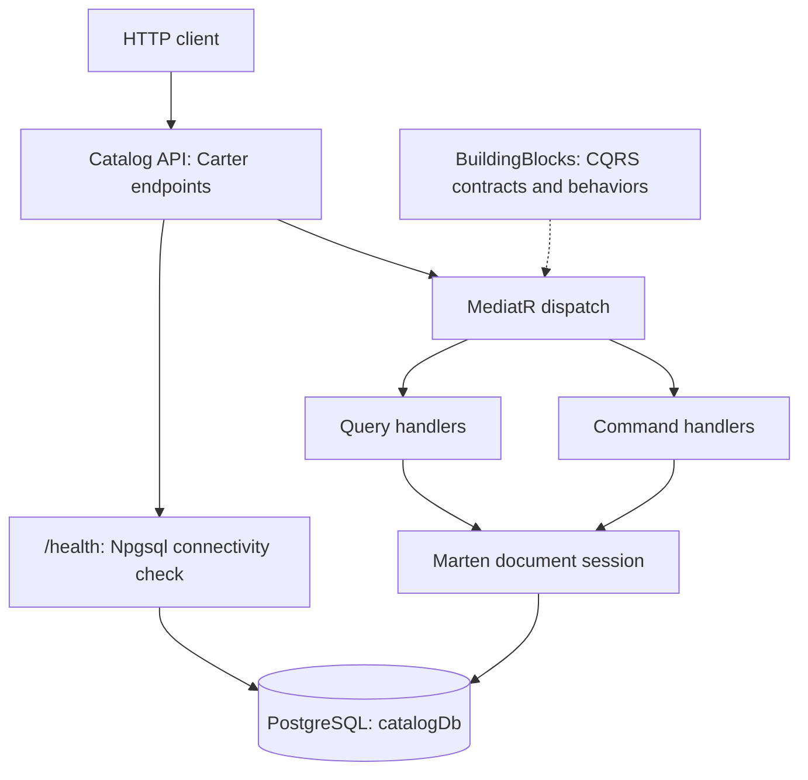
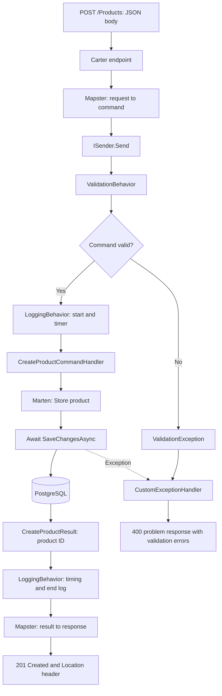

# EShopMicroservices

A work-in-progress e-commerce backend built with **C# and ASP.NET Core**, currently implementing a **Catalog API** and a reusable **BuildingBlocks** library.

The Catalog service demonstrates feature-based organization, CQRS with MediatR, Carter Minimal API endpoints, FluentValidation, Mapster, and document persistence with Marten on PostgreSQL. Docker configuration provides a containerized API and database development environment.

> **Current scope:** Catalog is the only application service in this repository. Basket, ordering, payments, an API gateway, messaging, authentication, and a frontend have not been implemented. The repository name describes the wider project direction.

## Contents

- [Implemented features](#implemented-features)
- [Technology stack](#technology-stack)
- [Architecture](#architecture)
- [Request flow](#request-flow)
- [Repository organization](#repository-organization)
- [Product model](#product-model)
- [HTTP API](#http-api)
- [Validation](#validation)
- [Persistence and seed data](#persistence-and-seed-data)
- [Shared building blocks](#shared-building-blocks)
- [Running locally](#running-locally)
- [Docker setup](#docker-setup)
- [API examples](#api-examples)
- [Current implementation notes](#current-implementation-notes)
- [License](#license)

## Implemented features

- Product creation with a generated identifier.
- Product listing with page number and page size parameters.
- Product lookup by identifier.
- Product filtering by category membership.
- Product update and delete endpoints and command handlers; see the implementation notes for current defects.
- Separate command and query contracts and handlers.
- Shared validation and logging behaviors in the MediatR pipeline.
- Central exception handling with structured problem responses.
- PostgreSQL connectivity health checks.
- Development-only initial product data.
- Multi-stage Docker build and Docker Compose configuration.

## Technology stack

Versions below are declared in the project files; they do not imply that a successful restore or build has been verified.

| Technology | Declared version / target | Role |
| --- | --- | --- |
| C# / ASP.NET Core | `net8.0` | Web API and shared library |
| Carter | 8.2.0 in Catalog; 8.0.0 in BuildingBlocks | Minimal API route modules |
| MediatR | 14.1.0 | Request dispatch and pipeline behaviors |
| FluentValidation | 12.1.1 | Command validation and assembly registration |
| Mapster | 10.0.8 | Request, command, result, and response mapping |
| Marten | 6.4.1 | Document storage and querying over PostgreSQL |
| PostgreSQL | Docker image `postgres:16` | Catalog database |
| Npgsql health checks | 9.0.0 | Database connectivity check |
| HealthChecks UI Client | 9.0.0 | JSON health report writer |
| Docker / Docker Compose | Configuration included | API build and local infrastructure |

BuildingBlocks also declares `Microsoft.AspNetCore.Diagnostics` 2.3.12. Catalog references BuildingBlocks directly.

## Architecture

The Catalog API uses **vertical feature slices**: each product operation has its own endpoint and handler files. Commands represent writes; queries represent reads. Both use the same Marten document database, so CQRS here separates application responsibilities rather than introducing separate read and write databases.

Endpoints use Carter to register routes, Mapster to adapt objects where needed, and MediatR's `ISender` to dispatch requests. Handlers receive an `IDocumentSession` through dependency injection and perform persistence operations.

BuildingBlocks contains reusable application contracts, behaviors, and exception handling.



There are currently no calls to other application services or message brokers.

## Request flow

The following flowchart describes the **create-product** path, including validation failure handling. Update and delete follow a similar command pipeline, but have the defects documented below. Queries use logging and their query handlers; the validation behavior is constrained to commands.



For product lookup, the query handler loads the document by ID. A missing document raises `ProductNotFoundException`, which is handled as a 404.

## Repository organization

Paths are relative to the repository root.

| Path | Responsibility |
| --- | --- |
| [eshop-microservices/eshop-microservices.sln](eshop-microservices/eshop-microservices.sln) | Visual Studio solution |
| [Catalog.API/Program.cs](eshop-microservices/Services/Catalog/Catalog.API/Program.cs) | Dependency registration, routes, exceptions, seeding, and health checks |
| [Catalog.API/Products](eshop-microservices/Services/Catalog/Catalog.API/Products) | Create, list, lookup, category filter, update, and delete slices |
| [Catalog.API/Model/Product.cs](eshop-microservices/Services/Catalog/Catalog.API/Model/Product.cs) | Product document |
| [Catalog.API/Data/CatalogInitialData.cs](eshop-microservices/Services/Catalog/Catalog.API/Data/CatalogInitialData.cs) | Development seed data |
| [Catalog.API/Exceptions](eshop-microservices/Services/Catalog/Catalog.API/Exceptions) | Product-specific not-found exception |
| [BuildingBlocks/CQRS](eshop-microservices/BuildingBlocks/BuildingBlocks/CQRS) | Command, query, and handler abstractions |
| [BuildingBlocks/Behavior](eshop-microservices/BuildingBlocks/BuildingBlocks/Behavior) | Validation and logging pipeline behaviors |
| [BuildingBlocks/Exceptions](eshop-microservices/BuildingBlocks/BuildingBlocks/Exceptions) | Shared exceptions and central exception handler |
| [Catalog.API/Dockerfile](eshop-microservices/Services/Catalog/Catalog.API/Dockerfile) | Multi-stage API image build |
| [docker-compose.yml](eshop-microservices/docker-compose.yml) | PostgreSQL image, API build, and named volume declaration |
| [docker-compose.override.yml](eshop-microservices/docker-compose.override.yml) | Development ports, environment, and mounts |

## Product model

| Property | Type | Purpose |
| --- | --- | --- |
| `Id` | `Guid` | Document identifier |
| `Name` | `string` | Product name |
| `Category` | `List<string>` | One or more category names |
| `Description` | `string` | Product description |
| `ImageFile` | `string` | Image filename/reference |
| `Price` | `decimal` | Product price |

`ImageFile` is stored as a value; the repository does not implement image upload or image serving.

## HTTP API

Routes below reflect the actual endpoint registrations.

| Method | Route | Operation | Success response |
| --- | --- | --- | --- |
| POST | `/Products` | Create a product | 201, ID body and `Location: /Products/{id}` |
| GET | `/products?pageNumber=1&pageSize=10` | List products | 200, object containing `products` |
| GET | `/products/{id}` | Get a product by GUID | 200, object containing `product` |
| GET | `/products/category/{category}` | Filter products by category | 200, object containing `products` |
| PUT | `/products` | Update a product; ID is in the body | 200, update response record |
| DELETE | `/products/{id}` | Delete a product | 200, success response record |
| GET | `/health` | Check PostgreSQL connectivity | Health report JSON |

Listing defaults to page 1 and page size 10. The handler uses Marten's `ToPagedListAsync`, but the public response exposes the product collection rather than pagination metadata. Category filtering checks `Category.Contains(category)` and is not paginated.

The endpoint modules declare names, summaries, descriptions, and response metadata. Swagger/OpenAPI document generation and Swagger UI are not configured in `Program.cs`.

## Validation

Validators are discovered from the Catalog assembly. `ValidationBehavior<TRequest,TResponse>` runs applicable command validators asynchronously, combines their failures, and throws a `ValidationException` before the handler executes.

| Command | Implemented rules |
| --- | --- |
| Create product | Name, category collection, and image file must be nonempty; price must be greater than zero |
| Update product | ID must be nonempty; name must be nonempty and 5–100 characters; price must be greater than 100 |
| Delete product | ID must be nonempty |

Create and update currently have different price and name rules. Description and individual category entries do not have explicit validation rules. Query pagination parameters do not have a dedicated validator.

## Persistence and seed data

- Marten is registered with `ConnectionStrings:Database` and lightweight sessions.
- Products are persisted as documents in PostgreSQL.
- Create uses `Store` followed by an awaited `SaveChangesAsync`.
- Lookup uses `LoadAsync<Product>`; listing and category filtering use document queries.
- Update loads and modifies a document, then calls `Update`.
- Delete loads a document and calls `Delete<Product>`; its existing-record condition needs correction.
- Development startup registers `CatalogInitialData` through `InitializeMartenWith`.
- Seeding checks whether **any** product already exists and returns if so; otherwise it stores the predefined products with fixed GUIDs.
- Seed products include phones and other category examples. Image filenames are sample references.

The local connection targets `localhost:5432/catalogDb`. Compose overrides the connection to use the database container hostname. The named `postgres_catalog` volume persists database files across container recreation.

## Shared building blocks

### CQRS contracts

- `ICommand<TResponse>` and `IQuery<TResponse>` wrap MediatR requests.
- `ICommandHandler<TCommand,TResponse>` and `IQueryHandler<TQuery,TResponse>` wrap MediatR handlers.
- Unit-returning command abstractions are also defined for operations without a response payload; current product commands return result records.

### Logging behavior

`LoggingBehavior` logs request and response type names and request data, measures handler duration with a stopwatch, and logs completion. It includes a performance-warning condition using `Elapsed.Seconds > 3`.

The current implementation logs completion only after a successful handler call. It does not provide a `finally` block for failed requests, and `Elapsed.Seconds` is the seconds component rather than total elapsed seconds.

### Exception handling

`CustomExceptionHandler` implements ASP.NET Core's `IExceptionHandler`. It logs the error message and UTC time and writes a `ProblemDetails` object containing the title, status, detail, request path, and trace ID.

| Exception | Mapped status |
| --- | --- |
| `ValidationException` | 400, with a `validationErrors` extension |
| `NotFoundExceptions`, including product-not-found | 404 |
| `InvalidServerException` | 500 |
| Other exceptions | 500 |

A shared `BadRequestException` class exists, but the handler has no explicit mapping for it; it currently falls through to 500.

### Health checks

`/health` runs the configured Npgsql database connectivity check and uses `UIResponseWriter.WriteHealthCheckUIResponse` to serialize the report. This is a JSON endpoint; a health dashboard is not configured.

## Running locally

### Prerequisites

- .NET 8 SDK for the declared project target.
- PostgreSQL 16, or Docker with the Compose plugin.
- A package set compatible with the target framework; see the current implementation notes.

These commands document the configuration in the repository. Restore, build, and runtime execution have **not** been verified as part of this documentation update.

### 1. Clone and enter the solution directory

```bash
git clone https://github.com/StarAskari/EShopMicroservices.git
cd EShopMicroservices/eshop-microservices
```

### 2. Start the database

With Docker, start only the database using the repository Compose configuration:

```bash
docker compose up -d catalogdb
```

Compose also loads `docker-compose.override.yml`, including Windows-oriented mounts under the API service. If Compose rejects these paths on your machine, use the standalone database alternative:

```bash
docker run --name eshop-catalogdb -e POSTGRES_USER=postgres -e POSTGRES_PASSWORD=postgres -e POSTGRES_DB=catalogDb -p 5432:5432 -v eshop_catalog_local:/var/lib/postgresql/data -d postgres:16
```

Choose one database startup method; both bind host port 5432. Wait until PostgreSQL is ready before starting the API.

The checked-in connection uses development credentials `postgres/postgres`. Override `ConnectionStrings:Database` through user secrets or environment configuration for your own environment.

### 3. Restore and run the API

Target the API project directly so the Visual Studio Docker Compose project does not require its tooling during CLI builds.

```bash
dotnet restore Services/Catalog/Catalog.API/Catalog.API.csproj
dotnet build Services/Catalog/Catalog.API/Catalog.API.csproj
dotnet run --project Services/Catalog/Catalog.API/Catalog.API.csproj --launch-profile http
```

The HTTP launch profile uses **http://localhost:5000** and sets the environment to Development, enabling seed data.

Check database connectivity:

```bash
curl http://localhost:5000/health
```

## Docker setup

The API Dockerfile uses separate ASP.NET runtime, SDK build, publish, and final stages. It restores the Catalog project and its BuildingBlocks reference, publishes the application, and starts `Catalog.API.dll` in the final image. A `Dockerfile.original` is also retained in the repository; Compose references `Dockerfile`.

From `eshop-microservices`:

```bash
docker compose up --build -d
docker compose logs -f catalog.api
```

| Component | Host address / port | Container port |
| --- | --- | --- |
| Catalog API HTTP | `http://localhost:6000` | 8080 |
| Catalog API HTTPS mapping | `https://localhost:6060` | 8081 |
| PostgreSQL | `localhost:5432` | 5432 |

The override sets the Development environment, configures the database connection, and mounts Visual Studio user-secret and HTTPS directories using `${APPDATA}`. These paths assume a Windows development environment and may need adjustment elsewhere. The HTTPS port mapping also requires a configured development certificate; use HTTP for initial checks.

`depends_on` establishes startup order, but the Compose configuration has no database readiness healthcheck or readiness condition. If the API starts before PostgreSQL is ready, inspect the logs and restart it after the database becomes available.

To stop the Compose services while retaining the named database volume:

```bash
docker compose down
```

## API examples

Examples use the local HTTP launch profile. For the containerized API, replace port 5000 with 6000. Shell examples use Bash syntax.

### Create a product

```bash
curl -i -X POST http://localhost:5000/Products \
  -H "Content-Type: application/json" \
  -d '{
    "name": "Sample Laptop",
    "category": ["Computers"],
    "description": "Example catalog product",
    "imageFile": "sample-laptop.png",
    "price": 1200
  }'
```

The endpoint returns 201 with the generated ID and a location header. Copy the returned ID for lookup, update, or delete.

### Read products

```bash
curl "http://localhost:5000/products?pageNumber=1&pageSize=10"
curl "http://localhost:5000/products/5334c996-8457-4cf0-815c-ed2b77c4ff61"
curl "http://localhost:5000/products/category/Smart%20Phone"
```

The fixed ID example refers to a predefined seed product and requires that development seeding has populated the database.

### Update a product

Replace `<product-id>` with an existing GUID.

```bash
curl -i -X PUT http://localhost:5000/products \
  -H "Content-Type: application/json" \
  -d '{
    "id": "<product-id>",
    "name": "Updated Laptop",
    "category": ["Computers"],
    "description": "Updated example product",
    "imageFile": "sample-laptop.png",
    "price": 1250
  }'
```

The update path currently does not await persistence, and its response property is misspelled `isSucess`; see below.

### Delete a product

```bash
curl -i -X DELETE "http://localhost:5000/products/<product-id>"
```

The delete endpoint is implemented but currently rejects existing products because of the inverted condition described below.

## Current implementation notes

These findings come from source inspection. This documentation change does not modify application behavior.

| Area | Current observation |
| --- | --- |
| Build verification | Both projects target `net8.0`, while several dependencies use newer major versions. Package/framework compatibility must be checked with restore and build before treating the startup instructions as verified. |
| Delete condition | `DeleteProductHandler.cs` throws `ProductNotFoundException` when `product != null`. The not-found check should apply when the loaded product is null. |
| Persistence completion | Update and delete call `SaveChangesAsync` without `await`, so their handlers can return before persistence completes and failures may escape normal request handling. |
| Update response mapping | The result uses `isSuccess`, while the response constructor uses `isSucess`. This name mismatch needs correction or explicit mapping; the response flag should not be assumed reliable. |
| Endpoint response metadata | Update and delete declare `CreateProductResponse` in `Produces`; category and ID lookups declare the list-products response type. These declarations differ from the actual response records. |
| Performance measurement | `Elapsed.Seconds > 3` checks the seconds component; use total elapsed time for a reliable duration threshold. |
| Bad-request exception | `BadRequestException` is defined but has no dedicated 400 mapping. |
| Validation consistency | Create and update enforce different price/name rules; pagination lacks explicit input validation. |
| Cancellation | Some async database calls do not forward the request cancellation token. |
| Security | No authentication, authorization, credential exchange, or token handling is configured. |
| API tooling and tests | No Swagger UI, test project, or CI workflow is included in the inspected repository. |

## License

This project is licensed under the [MIT License](LICENSE).

Copyright © 2026 Nafiseh (Setareh) Askari.
